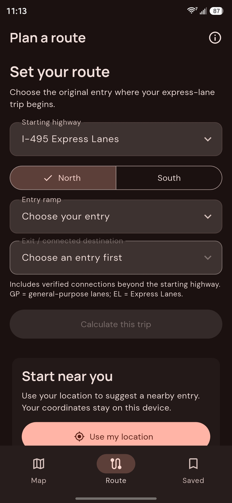
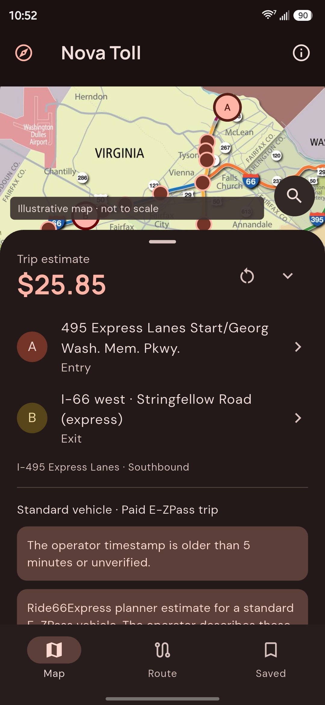
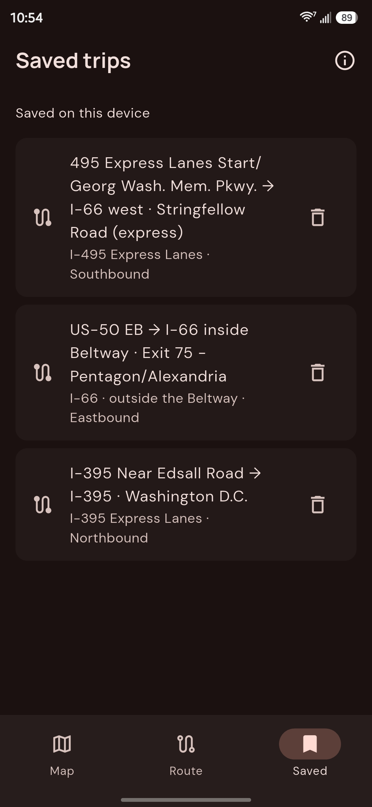

# Nova Toll

Northern Virginia’s dynamic express-lane tolls can be surprisingly high. Planning ahead is harder when your trip crosses highways or toll operators, leaving you without a straightforward way to estimate the full trip cost in one place.

Nova Toll for Android addresses both problems with robust cross-highway toll estimates. Choose your entry and exit on the map to combine available operator estimates for supported connections, review each segment’s cost, and save routes you use often. Missing prices and incomplete totals are clearly flagged so you can make an informed choice before entering the lanes.

See the [Nova Toll showcase](https://alchemist-aloha.github.io/NovaToll/) for a visual tour of the app.

## See Nova Toll in action

<table>
  <tr>
    <td align="center">
      
       <em>Plan a route manually</em>
    </td>
    <td align="center">
      
       <em>Review the toll estimate</em>
    </td>
    <td align="center">
      
       <em>Save frequent routes</em>
    </td>
  </tr>
</table>

## Coverage

- **I-495, I-95, and I-395 Express Lanes**
- **I-66 inside the Beltway**
- **I-66 outside the Beltway**

Estimates are for a standard paid E-ZPass trip. An internet connection is required to request prices from the toll operators.

## Install on Android

Download the APK for your device from the repository's **Releases** page.
Versioned GitHub Actions builds automatically attach all three APKs to their
release. Development builds are available as **nova-toll-android-apks** under a
successful **Android APKs** run in **Actions**; extract that archive to find the APKs.

Open the Nova Toll APK on your Android device and follow the installation prompts. If Android asks, allow the app you used to open the APK to install unknown apps.

If you have a choice of APKs, select the one for your device:

| APK | Device type |
| --- | --- |
| `app-arm64-v8a-release.apk` | Most current Android phones |
| `app-armeabi-v7a-release.apk` | Older, 32-bit ARM devices |
| `app-x86_64-release.apk` | x86 Android devices and emulators |

## Plan a trip

1. **Choose your entry.** Pan or pinch to zoom the map, then tap a ramp. Use search to find a ramp by name.
2. **Choose your exit.** After selecting an entry, the map shows reachable destinations. Confirm the ramp and travel direction when prompted.
3. **Check the estimate.** Expand the trip details to review the price, source, and any availability or freshness warnings.

Prefer a list? Open the manual route planner, select your highway, direction, entry, and destination, then tap **Calculate this trip**.

**Use my location** can suggest a nearby entry. Confirm the direction and ramp yourself; if you are already in the lanes, select your original entry.

## Refresh and save

Tap **Refresh price** to request another estimate. **Refresh every 60 seconds** updates estimates while the results are visible and the app is active.

Tap **Save this trip** to keep a route on your device. Open **Saved** to load it again or delete it. Saved routes do not lock in a price.

## Understand your estimate

Posted roadside prices govern. Estimates may change, and unavailable or incomplete prices should not be treated as free travel.

A recent refresh does not guarantee a newly updated rate. Use **Sources & coverage** to open the official operator websites.

Map markers are approximate. Construction notes in the map artwork are historical and do not describe current road conditions. Nova Toll is an independent trip planner; verify ramp names and road signs. Use it while parked or have a passenger operate it.

## Your privacy

No account is required. Saved trips stay on your device, with no account sync. If local storage is unavailable, new saved trips last only for the current session.

Location is optional and requested for a one-time entry suggestion. Your coordinates stay on your device and are not sent to toll services.

## Contributing

For development setup, build commands, and testing guidance, see [Repository Guidelines](AGENTS.md).
For GitHub Actions signing setup and APK downloads, see [Android builds](docs/android-builds.md).

## License

Nova Toll's original code and documentation are available under the [MIT License](LICENSE),
which allows reuse, modification, and redistribution while retaining the copyright
and license notice. Bundled fonts use SIL OFL 1.1, and supplied map artwork is not
covered by MIT. See [third-party notices](THIRD_PARTY_NOTICES.md) for attribution
and asset licensing details.
